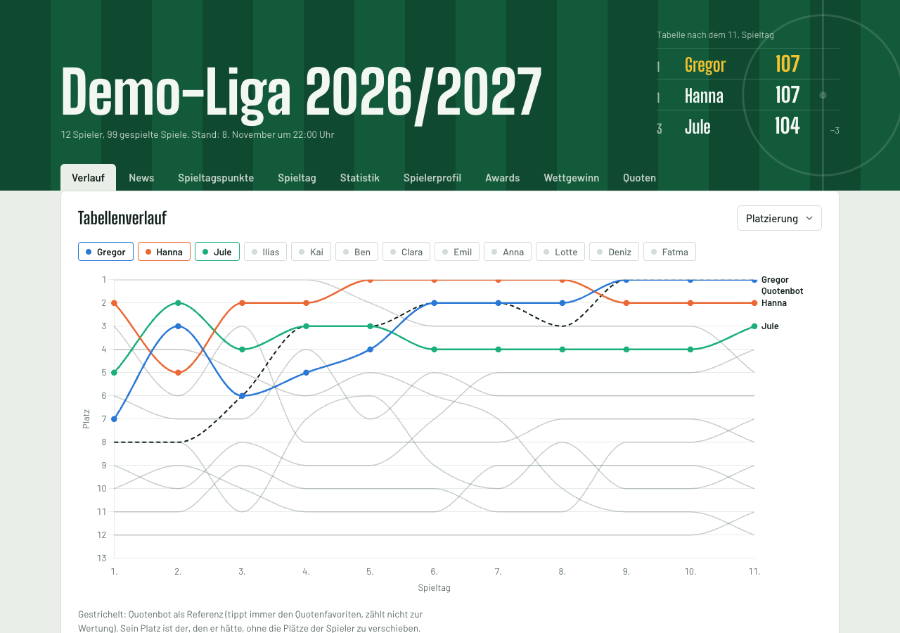
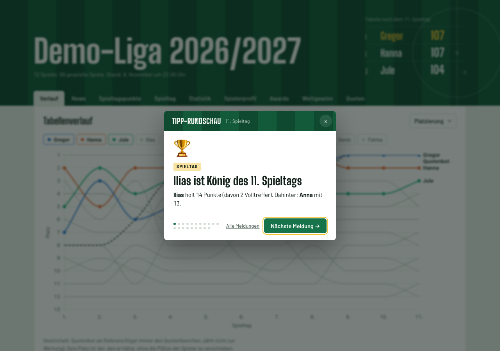
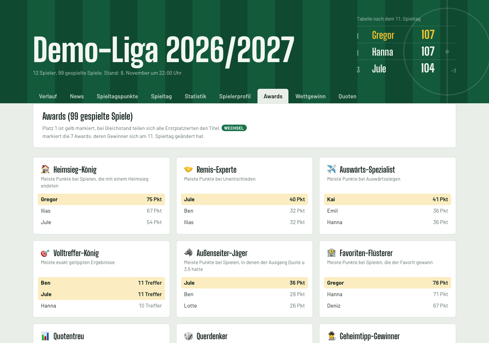
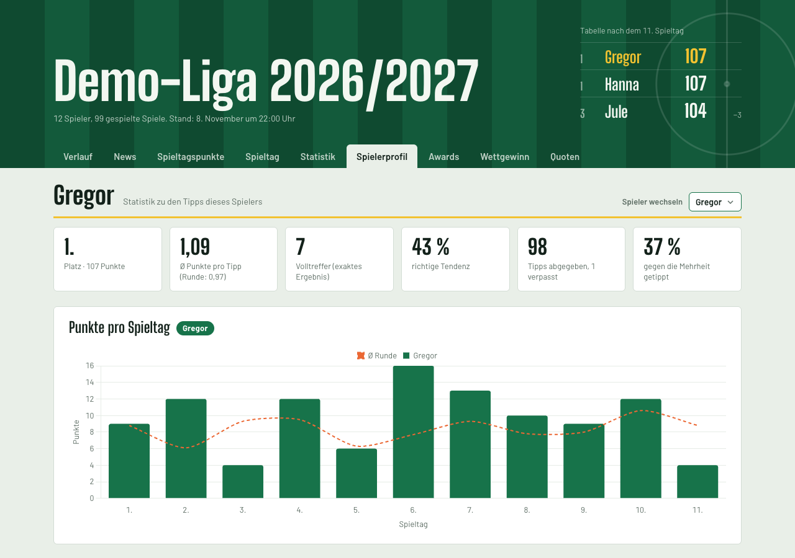

# Kicktipp Viewer

A statistics page for your [Kicktipp](https://www.kicktipp.de) prediction league. It scrapes your league's matches,
results, everybody's tips and (optionally) the betting odds, and turns them into standings history, player profiles,
awards, a matchday "newspaper" and a "what if we had bet real money" ranking.

Runs as a single Docker container that serves the page and keeps the data up to date by itself.
No database, no build step, no npm dependencies. The page itself is in German, just like Kicktipp.



| | |
|---|---|
|  |  |
|  | |

## Features

- **Verlauf**: standings and points over the season, per player
- **News**: a generated "Tipp-Rundschau" for every matchday (also shown as a pop-up on each visit)
- **Spieltagspunkte / Spieltag**: points per matchday, everybody's tips per match
- **Statistik / Spielerprofil**: hit rates, favourite results, contrarian tips, points per team, …
- **Awards**: from "Volltreffer-König" to "Durststrecke", with changes since the last matchday highlighted
- **Wettgewinn**: profit/loss if everybody had bet €1 on the outcome of each tip
- **Quoten**: odds vs. how the league tipped
- **Quotenbot**: a reference player that always tips the odds favourite (2:1, 1:1 or 1:2)

The odds-based parts need a Kicktipp login (see below); without it they're simply hidden.

## Try it

```bash
docker build -t kicktipp-viewer .
docker run --rm -p 8080:8080 -e DEMO=true kicktipp-viewer
```

Open http://localhost:8080. `DEMO=true` serves a made-up league (`demo/data.json`) and never contacts Kicktipp.

## Run it for your league

```bash
cp .env.example .env        # set at least KICKTIPP_SLUG
docker compose up -d        # http://localhost:8080
```

or with a published image:

```bash
docker run -d --name kicktipp -p 8080:8080 -v kicktipp-data:/data \
  -e KICKTIPP_SLUG=my-league ghcr.io/knaufk/kicktipp-viewer:latest
```

| Variable | Required | Meaning |
|---|---|---|
| `KICKTIPP_SLUG` | yes | Your league, from the URL `https://www.kicktipp.de/<slug>/` |
| `KICKTIPP_EMAIL`, `KICKTIPP_PASSWORD` | no | Login of a league member, only needed for the betting odds |
| `BASIC_AUTH_USER`, `BASIC_AUTH_PASSWORD` | no | Password-protect the page (empty = no protection) |
| `PORT` | no | Port inside the container (default `8080`) |
| `ODDS_HOUR` | no | Hour (Berlin time) of the daily full update (default `6`) |
| `DEMO` | no | `true` serves the demo data instead of your league |

Data is stored in the volume `/data` (`data.json`, `odds.json`). Keep the volume: Kicktipp doesn't show odds for past
matchdays, so `odds.json` can't be fetched again.

### Updates

- **On start:** full update (odds if a login is set, then matches, results and tips).
- **Every 15 minutes:** if a match has ended (kick-off + 2 h) and has no result yet, fetch the public tip overview
  again. Gives up 6 h after the expected end (e.g. postponed matches).
- **Daily from `ODDS_HOUR`:** full update. Odds of matches that have kicked off are frozen at their last value.

Logs go to stdout (`docker logs kicktipp`). Health check: `GET /healthz`.

### Exposing it to the internet

The page shows your league members' names and tips. If it's reachable from the internet, protect it: either set
`BASIC_AUTH_USER`/`BASIC_AUTH_PASSWORD` (and put a TLS-terminating reverse proxy in front), or let the reverse proxy
handle authentication. The Kicktipp password is stored in the container's environment, so don't reuse it anywhere else.

## Development

Requires Node ≥ 22, nothing else.

```bash
export KICKTIPP_SLUG=<slug>
npm run update              # odds (asks for e-mail/password unless set) + export
node export/export.mjs      # matches, results and tips only, no login
npm run serve               # serve the page without updating: http://localhost:8080
npm start                   # serve + update, like the container
npm run demo                # serve the demo data
```

Data goes to `data/` (or `DATA_DIR`).

| Path | Purpose |
|---|---|
| `public/index.html` | The whole page: one file, inline CSS and vanilla JS, reads `data.json` |
| `public/vendor/` | Chart.js and fonts, served locally (no requests to third parties) |
| `server.mjs` | Static file server, optional Basic Auth, update scheduler (container entry point) |
| `auto-update.mjs` | Decides whether an update is needed and runs it |
| `export/export.mjs` | Scrapes the public tip overview → `data.json` (no login) |
| `export/fetch-odds.mjs` | Logs in and scrapes the odds of all matchdays → `odds.json` |
| `export/odds-snippet.js` | Alternative: paste into the browser console on the tip submission page to download `odds.json` |
| `demo/generate.mjs` | Generates the made-up demo data |

Kicktipp is parsed with regular expressions on its HTML, so a redesign on their side will break the scraper. Kick-off
times are Berlin local time.

## Limitations

- Tested with regular leagues that have matchdays (e.g. Bundesliga). Tournaments, bonus questions and special scoring
  modes may not be parsed correctly.
- Points per category (exact / goal difference / tendency) are read from your league's tips; the standard 4/3/2 is
  used until there is data.
- Odds are the value at the last fetch before kick-off, not necessarily the closing odds.

## Disclaimer

This is an unofficial hobby project, not affiliated with or endorsed by Kicktipp. It reads pages that every league
member can see, with a pause between requests. Check Kicktipp's terms of use and your league's consent before
publishing anything, and use it at your own risk.

## License

[MIT](LICENSE). Bundled third-party files: [Chart.js](https://www.chartjs.org) (MIT), fonts
[Barlow](https://github.com/jpt/barlow) and [Big Shoulders Display](https://github.com/xotypeco/big_shoulders)
(SIL Open Font License 1.1); licenses in `public/vendor/`.
